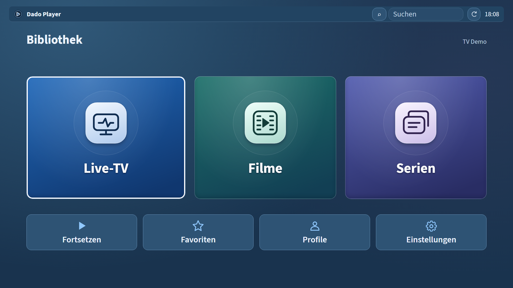
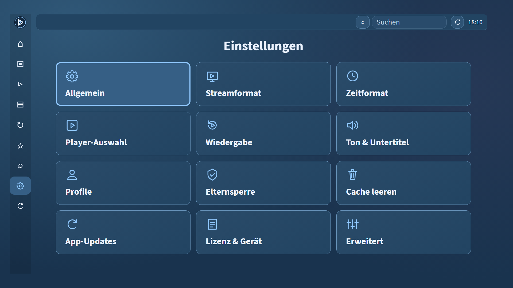

# Dado Player

Ein IPTV-Player für eigene M3U-Playlists und Xtream-Codes. Live-TV, Filme und Serien bleiben in einer Bibliothek organisiert.

Gemeinsamer Download für Windows, Android, iOS und Samsung Tizen: [**0.8.5**](https://github.com/tariktech7/dado-player/releases/tag/v0.8.5).

## Downloads

| Plattform | Paket und Einrichtung |
| --- | --- |
| Windows | `Dado-Player.exe` herunterladen und direkt starten. |
| Android | `Dado-Player-arm64-debug.apk` herunterladen und über Android installieren. |
| iOS | `Dado-Player-unsigned.ipa` herunterladen und für das eigene Gerät signieren. [iOS-Anleitung](ios/README.md) |
| Samsung Tizen | Das WGT für dein Modell herunterladen und mit deinem Samsung-Entwicklerzertifikat signieren. Eine installierte App prüft unter **Einstellungen → App-Updates** den TV-Kanal. [Samsung-Anleitung](SmartTV/client/README.md) |

## Funktionen

- **Live-TV** mit Senderliste, Favoriten und Programmübersicht, sofern der Anbieter EPG-Daten liefert.
- **Filme und Serien** mit eigenen Detailseiten, Staffel- und Folgenwahl sowie zufälliger Folgenwiedergabe.
- **Profile und Wiedergabeverlauf** mit separat abschaltbarer Funktion „Fortsetzen“ und PIN-geschützter Elternsperre.
- **Klassische und moderne Oberfläche** für Maus, Touch oder Fernbedienung, je nach Plattform.

*Die Screenshots stammen aus dem TV-Demo-Modus. Für die Wiedergabe werden eigene Quellen benötigt.*

## Dokumentation

- [Build, Paketierung und Updates](docs/BUILD.md)
- [Plattformen und Funktionsumfang](docs/PLATFORM-PARITY.md)
- [Elternsperre](docs/PARENTAL-CONTROLS.md)
- [Dado Connect](connect/README.md)
- [Änderungen je Version](https://github.com/tariktech7/dado-player/releases)
